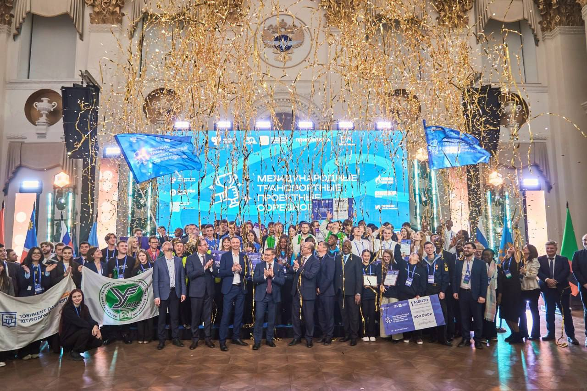
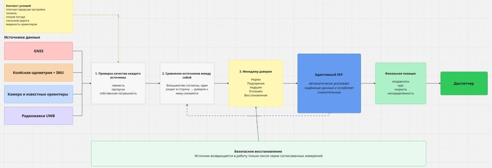
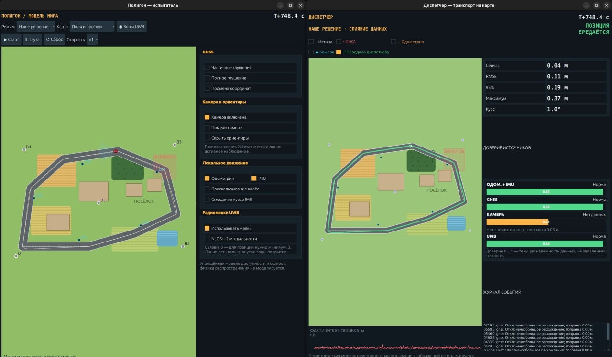
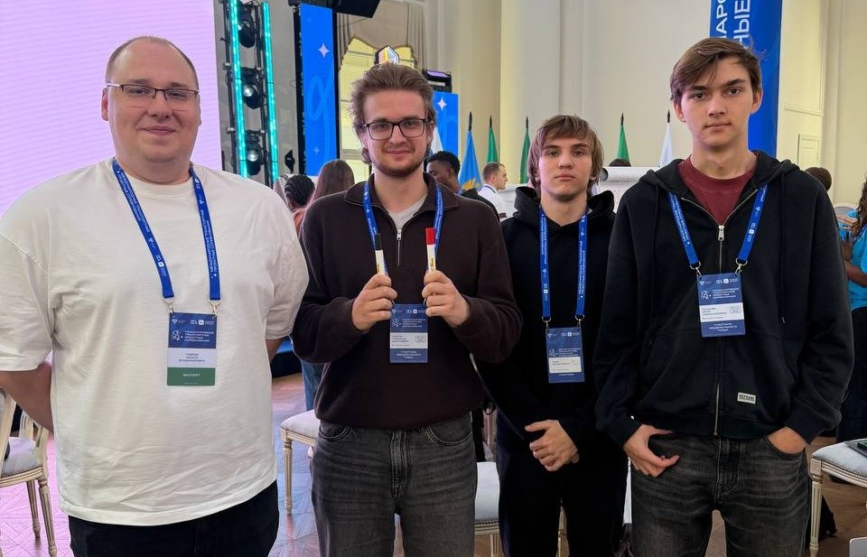

# Устойчивое позиционирование транспорта при сбоях GNSS

Проект команды **«МИСИС крутые перцы»** из НИТУ МИСИС для Международных
транспортных проектных соревнований РУТ (МИИТ). Заказчик кейса № 4 —
**ФАУ «РОСДОРНИИ»**.

<p align="center">
  
</p>

## О кейсе

Интеллектуальные транспортные системы получают координаты транспорта через
GNSS. В тоннелях, плотной городской застройке, при помехах или подмене сигнала
машина может исчезнуть с цифровой карты либо оказаться в неверной точке, которой
система продолжает доверять.

Наша задача — сохранить оценку положения, направления и скорости транспорта,
а также явно сообщить диспетчеру, когда качество координат ухудшилось.

## Для кого мы делаем решение

- **Диспетчеры региональных ИТС** — чтобы непрерывно видеть транспорт на карте и
  не принимать ложную координату за достоверную.
- **ФАУ «РОСДОРНИИ», владельцы и эксплуатанты дорог** — чтобы проверять
  сценарии потери GNSS и формировать измеримые требования к системам.
- **Разработчики беспилотного и подключённого транспорта** — чтобы подключать
  резервные источники позиционирования без полной замены бортовой системы.
- **Логистические и транспортные компании** — чтобы сохранять контроль маршрута
  на проблемных участках.

## Наше решение

Мы разработали демонстратор **гибридной локализации с адаптивным контролем
доверия**. Он объединяет:

- GNSS;
- колёсную одометрию и IMU;
- камеру и известные визуальные ориентиры;
- радиомаяки UWB на критических участках.

Каждый источник сначала проверяется по свежести, собственной неопределённости и
согласованности с другими источниками. Менеджер доверия в реальном времени
ослабляет сомнительные данные, а адаптивный EKF формирует итоговую позицию и её
неопределённость. Источник после сбоя возвращается в работу только по серии
согласованных измерений.

<p align="center">
  
</p>

## Что показывает прототип

В демонстраторе есть два режима:

1. **Обычный подход — только GNSS.** При глушении точка пропадает у диспетчера,
   при подмене смещается без независимой проверки.
2. **Наше решение.** При потере GNSS положение продолжает вычисляться по
   доступным источникам, а влияние противоречивых измерений снижается.

Оператор может вручную включать глушение и подмену GNSS, отключать камеру,
одометрию, IMU и UWB, перемещать радиомаяки и наблюдать изменение доверия,
ошибки и ковариации фильтра. Доступны четыре компактные карты: плотный город,
поля и посёлок, лесная дорога, тоннели и развязка.

<p align="center">
  
</p>

## Команда

<p align="center">
  
</p>

| Участник | Роль | Вклад в проект |
|---|---|---|
| **Голышев Юрий Александрович** | Руководитель команды | Определял порядок работы, объединял результаты в единое решение, формулировал проблему и карту заинтересованных сторон, готовил презентацию и материалы для защиты. |
| **Кулагин Александр Дмитриевич** | Разработчик модели | Прорабатывал техническую архитектуру и сценарии потери GNSS, реализовывал и проверял прототип, готовил техническое описание решения. |
| **Галаев Николай Павлович** | Инженер по интеграции | Исследовал существующие решения и профильных специалистов, систематизировал источники, готовил таблицы и схемы, объединял материалы команды и контролировал качество презентации. |

## Презентация

Актуальная презентация команды: **[открыть PDF](docs/presentation.pdf)**.

В папке [`01_Финальные_презентации`](01_Финальные_презентации/) сохранены
материалы всех этапов соревнований в форматах PDF и PPTX.

## Запуск ROS 2-демонстратора

Требуются Ubuntu 24.04, ROS 2 Jazzy, Python 3.12, NumPy и PyQt5.

```bash
cd 02_Прототип/ros2_gnss_resilient_demo
./run_demo.sh
```

Ручная сборка:

```bash
source /opt/ros/jazzy/setup.bash
colcon build --packages-select gnss_resilient_demo --symlink-install
source install/setup.bash
ros2 launch gnss_resilient_demo demo.launch.py
```

Подробности находятся в
[`README демонстратора`](02_Прототип/ros2_gnss_resilient_demo/README.md), а
готовый порядок показа — в
[`сценарии демонстрации`](02_Прототип/ros2_gnss_resilient_demo/DEMO_SCRIPT_RU.md).

## Структура репозитория

- `01_Финальные_презентации/` — презентации этапов соревнований;
- `02_Прототип/ros2_gnss_resilient_demo/` — актуальный ROS 2-симулятор;
- `02_Прототип/prototype_gnss/` — ранний браузерный прототип;
- `03_Видеозащита/` — сценарий видеозащиты;
- `docs/` — актуальная презентация, схема и фотографии.

## Ограничения

Прототип работает на синтетических данных. Он не подтверждает точность реального
оборудования, не является сертифицированной системой безопасности и не
гарантирует обнаружение любого спуфинга. Камера моделируется геометрически по
известным ориентирам, UWB — по виртуальным дальностям. Для реального применения
нужны натурные испытания, калибровка и проверка на конкретном маршруте.

Сайт соревнований: [contest.rut-miit.ru](https://contest.rut-miit.ru/main)
